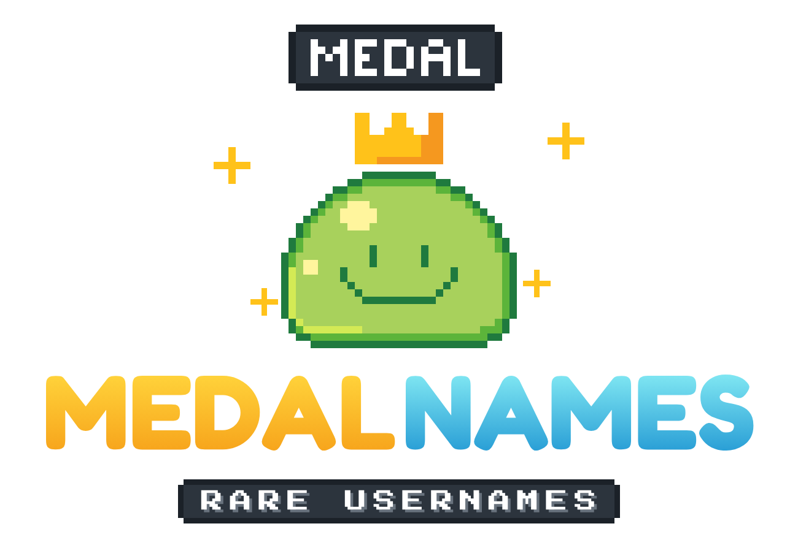

# MedalNames: branding

Winkel voor Minecraft-accountnamen: zeldzame en OG-namen (MedalNames.com). Onderdeel van de Medal-familie naast [MedalCapes](https://medalcapes.com) en MedalMC Network. Een project van Codastra.



## Naam

**MedalNames** (`medalnames.com`)

- Dezelfde opbouw als MedalCapes: "Medal" plus het product. Daardoor herken je het direct als hetzelfde merk.
- Meteen duidelijk wat er te koop is, en goed vindbaar op zoektermen als "minecraft names".

> **Let op:** de voorwaarden van Microsoft en Mojang verbieden het verkopen of overdragen van Minecraft-accounts. Microsoft kan zulke accounts blokkeren, en betaalproviders (Stripe, PayPal) kunnen zulke verkopers afsluiten. Houd MedalNames daarom qua betalingen en juridische entiteit gescheiden van MedalCapes en MedalMC, zodat een ban of chargeback-probleem de andere merken niet raakt.

## Logo

- Dezelfde gekroonde pixel-slime als MedalCapes en MedalMC.
- Erboven een **zwevend naamplaatje** met "MEDAL", zoals spelersnamen in-game boven je hoofd zweven. Dat verwijst direct naar het product.
- Wordmark in **Fredoka Bold**: "MEDAL" goud, "NAMES" in **diamant-blauw** als eigen accentkleur. MedalMC is groen, MedalNames blauw.
- De tagline "RARE USERNAMES" staat in een naamplaatje in **Press Start 2P**.

| Bestand | Gebruik |
|---|---|
| `png/medalnames-logo.png` / `@2x` | Hoofdlogo |
| `png/medalnames-logo-horizontal.png` / `@2x` | Navigatiebalk van de website, banners |
| `png/medalnames-icon-512.png` | Mascotte-icoon (transparant) |
| `png/medalnames-icon-dark-512.png` | Discord, social media-avatars |
| `svg/*.svg` | Vectorversies (tekst omgezet naar paden) |

### Kleuren

| Naam | Hex |
|---|---|
| Goud | `#ffc21a` (verloop `#ffd23a` → `#f7a51c`) |
| Diamant-blauw | verloop `#7fe6f2` → `#2a9fd6` |
| Naamplaatje | `#2c343d`, rand `#1b2128`, tekst `#ffffff` |
| Slime | `#a8d15c` / `#5cb43a` / `#1f7a3e` |
| Achtergrond donker | `#120800` |

## Opnieuw genereren

```bash
cd source
npm install
node make.js ../svg && node export.js ../svg ../png   # PNG-export vereist Playwright
```

Een andere tagline zet je via `TAG` in `make.js`, bijvoorbeeld `OG NAMES` of `MINECRAFT NAMES`.
