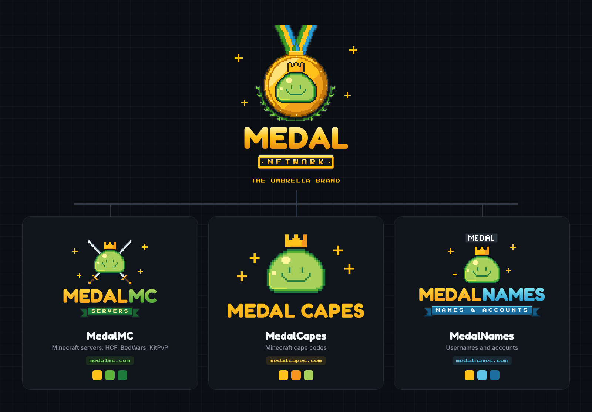

# Medal Network: brand kit

Eén visueel systeem voor alle merken van Medal Network, een project van Codastra.



| Merk | Waarvoor | Kleur | Element |
|---|---|---|---|
| **Medal Network** | Overkoepelend merk | Goud + de drie merkkleuren | Gouden pixel-medaille met de slime, een lint in drie kleuren en een lauwerkrans. Ondertitel op een trofee-plaquette: NETWORK |
| **MedalMC** | Minecraft-servers (HCF, BedWars, KitPvP) | Groen | Slime met gekruiste zwaarden en een groen lint: SERVERS |
| **MedalCapes** | Cape-codes | Goud | Het bestaande logo van medalcapes.com (`capes/png`) |
| **MedalNames** | Namen en accounts | Blauw | Slime met een zwevend in-game naamplaatje en een blauw lint: NAMES & ACCOUNTS |

**Gedeeld door alle merken:**
- **Mascotte:** de gekroonde slime van MedalCapes.
- **Wordmark:** "MEDAL" in Fredoka Bold met een gouden verloop.
- **Pixel-elementen:** de sparkles en Press Start 2P.

Het lint van de Network-medaille bevat de kleuren van de drie merken: groen (MC), goud (Capes) en blauw (Names).

## Bestanden
Per merk (`network/`, `mc/`, `names/`):
- `svg/`: het staande logo, het horizontale logo, een transparant icoon en een icoon op een donkere achtergrond. De tekst is omgezet naar paden.
- `png/`: dezelfde bestanden als PNG, de logo's ook in `@2x`.
- `mc/png/server-icon.png`: de Minecraft server-icon (64×64) voor de map van je proxy.

## Kleuren
| | Hex |
|---|---|
| Goud | `#ffc21a`, verloop `#ffd23a` → `#f7a51c` |
| MC-groen | `#5cb43a`, lint `#1f7a3e` |
| Names-blauw | `#5ec5e8`, lint `#1b6fa0` |
| Slime | `#a8d15c` / `#5cb43a` / `#1f7a3e` |
| Donker | `#0b0e13` / `#1b2128` |

## Opnieuw genereren
```bash
cd source
npm install opentype.js @fontsource/fredoka @fontsource/press-start-2p playwright
npm run build
```
Teksten pas je aan in `BRANDS` in `make.js`, bijvoorbeeld het lint "SERVERS" of "NAMES & ACCOUNTS".
