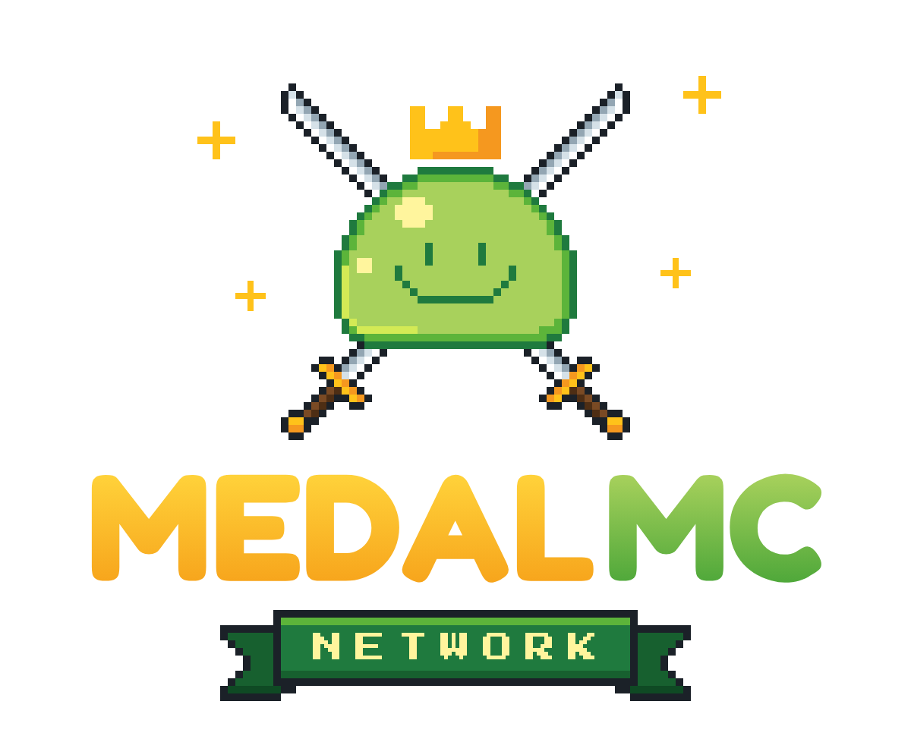

# MedalMC Network: branding

Een uitbreiding van [MedalCapes](https://medalcapes.com) naar een Minecraft-servernetwerk (hub + HCF, BedWars, KitPvP en later meer). Een project van Codastra.



## Naam

**MedalMC** (voluit *MedalMC Network*)

- "Medal" blijft herkenbaar, zodat MedalCapes en de server één merk vormen.
- "MC" is de gebruikelijke Minecraft-serverconventie, kort en makkelijk te typen als IP, bijvoorbeeld `play.medalmc.net`.
- Alleen "Medal" ligt dicht bij Medal.tv, een groot clip-platform voor gamers. "MedalMC" maakt het onderscheid duidelijker.
- Gebruik geen "Minecraft" in de naam. Dat staat in de richtlijnen van Mojang. "MC" wordt algemeen geaccepteerd.

Alternatieven die zijn overwogen: *Medal Network* (`play.medal.network`), *MedalCraft*, *MedalPvP* (te smal als er later niet-PvP-modi bijkomen).

> Controleer vóór de lancering of het domein vrij is (bijvoorbeeld `medalmc.net`, `.com`, `.gg`) en of de handles op Discord, TikTok en X vrij zijn.

## Logo

Het logo hoort duidelijk bij MedalCapes:

- dezelfde pixel-slime met gouden kroon (pixel voor pixel gelijk aan de favicon van medalcapes.com);
- **gekruiste zwaarden** erachter voor het PvP-netwerk, in de vorm van een wapenschild;
- dezelfde wordmark-letter: **Fredoka Bold**, met een gouden verloop. "MC" heeft het slime-groen;
- een pixel-lint met "NETWORK" in **Press Start 2P**, de pixelfont van medalcapes.com;
- dezelfde gouden sparkles als in het MedalCapes-logo.

| Bestand | Gebruik |
|---|---|
| `png/medalmc-logo.png` / `@2x` | Hoofdlogo: website, store, trailers |
| `png/medalmc-logo-horizontal.png` / `@2x` | Navigatiebalk, banners, Discord-header |
| `png/medalmc-icon-512.png` | Mascotte-icoon (transparant) |
| `png/medalmc-icon-dark-512.png` | Discord-servericoon, social media-avatars |
| `png/server-icon.png` | **Minecraft server-icon (64×64)**. Zet het in de hoofdmap van de proxy (Velocity of BungeeCord) |
| `svg/*.svg` | Vectorversies (tekst omgezet naar paden, geen fonts nodig) |

### Kleuren

| Naam | Hex |
|---|---|
| Goud | `#ffc21a` (verloop `#ffd23a` → `#f7a51c`) |
| Oranje | `#f5981f` |
| Slime licht | `#a8d15c` |
| Slime midden | `#5cb43a` |
| Slime donker / lint | `#1f7a3e` |
| Highlight | `#fff59d` |
| Achtergrond donker | `#120800` |

Kleurcodes voor MOTD en chat: `&6` (goud) voor "Medal", `&a` (groen) voor "MC".

## Opnieuw genereren

```bash
cd source
npm install
npm run build   # schrijft ../svg en ../png (voor PNG-export is Playwright nodig)
```

Pas `make.js` aan voor andere teksten of varianten, bijvoorbeeld een lint met "HCF", "BEDWARS" of "KITPVP" per gamemode: `ribbon(cx, top, s, 'HCF')`.
